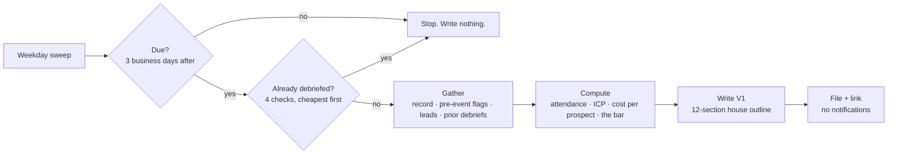

# Event Debrief: honest post-event write-ups, on autopilot

> **Outcome:** three business days after every event, a fully sourced debrief draft is waiting in the event's folder. It has every number with its source, every gap named as a question, and the outcome fields deliberately left for people to fill in.

A [Claude skill](https://docs.claude.com/en/docs/agents-and-tools/agent-skills/overview) I built to close the loop on event programs. It runs as a weekday scheduled task and stays silent on days when nothing is due.

---

## The problem

Debriefs are where event programs learn, and they're also the first thing to slip. When they do get written, they're often reconstructed from memory a week later, mixed with optimism, and full of numbers nobody can trace. Then *those* numbers decide next year's sponsorship.

## How it works

## The rules that make it trustworthy

1. **Every figure has a source:** the file, its row count, and the date it was read.
2. **Anything unsourced becomes an open question, never an estimate.**
3. **Nothing is invented,** including meeting counts, sentiment, and what was said in the room. If nobody wrote it down, the V1 says so.
4. **People keep the outcome numbers.** Meetings, qualified leads, opportunities, T+90 pipeline and the verdict stay blank. They feed next year's prior-performance score, so letting the AI fill them in would quietly distort how the next sponsorship gets priced. **AI drafts and gathers evidence. The team decides.**

## The section I care about most

Every V1 has to lead with **one finding that reframes the debrief**, found by looking for two numbers that should agree but don't.

> *44 registrants clicked "join" on a partner webinar, but only 33 got in. That's a technical failure, not an interest failure, and it was invisible in our own export.*

That one line changes the next action from "the topic didn't land" to "send a backup link," which costs nothing to try.

See the full made-up example: [`examples/EVT-014_DEBRIEF_CFORoundtable.md`](examples/EVT-014_DEBRIEF_CFORoundtable.md)

## Other design choices

- **Pre-event flags are the starting point.** Concerns logged *before* the event are each marked confirmed, corrected, or "cannot settle." That last one is a real answer.
- **Title alone is the wrong follow-up filter.** The V1 shows who a title rule misses (senior people who stayed engaged but have the "wrong" title) and proposes a qualified-lead rule *for the call to decide*.
- **Next steps are listed cheapest first,** one variable per line, ending with **HOLD CONSTANT** so the next event is still a clean comparison.
- **Theories carry forward.** Prior debriefs for the same series are read, and every old theory needs a verdict.
- **Quiet days stay quiet.** No "nothing to report" docs and no pings.

## What's in the repo

| Path | What it is |
|---|---|
| `SKILL.md` | The full skill: due-date logic, skip checks, gather → compute → write → file |
| `config.md` | Per-team settings: tracker, commercial assumptions, ICP rule, naming (example values) |
| `templates/debrief-outline.md` | The 12-section house outline |
| `examples/` | A complete made-up V1 debrief |

## Use it

1. Add the folder to your Claude skills and fill in `config.md`.
2. Connect your event tracker (e.g. Notion) and file storage (e.g. Google Drive).
3. Schedule a weekday task: *"Run the event debrief sweep."* Or ask any time: *"Write the V1 debrief for EVT-014."*

---

*Part of my [event ops toolkit](https://github.com/parker-lauren): [vet the event](https://github.com/parker-lauren/event-vetting) → [clean the leads](https://github.com/parker-lauren/event-contact-list) → debrief honestly. All events, people and numbers here are made up.*
